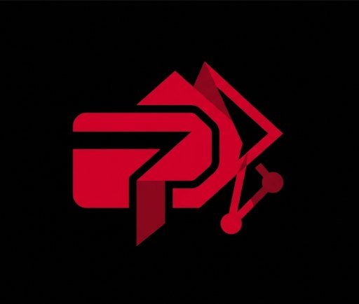

<p align="center">
  
</p>

# PayFold

> **Autonomous Hackathon Prize Distribution & Web3 Payout Automation Platform**  
> *Developed & Maintained by **Lakshay Deol** (<lakshayld26@gmail.com>)*  
> *Built for **NEAR HACKATHON 2026***  
> **Links**: [GitHub Repository](https://github.com/Lakshay-Deol/payfold) | [Demo Video Walkthrough](https://youtu.be/payfold-demo)

---

## Overview

**PayFold** is a decentralized, autonomous payout execution system designed for hackathon organizers, grant programs, and Web3 event managers. It eliminates the friction of collecting wallet addresses, validating recipients, and sending prize payouts one-by-one.

With PayFold:
1. **Organizers Announce Winners**: Connect a Web3 wallet (MetaMask/Rainbow on Aurora/Sepolia) and enter hackathon winner details (Winner Name, Email, Prize Amount, Place, and Track).
2. **Escrow Locked On-Chain**: Prize funds are deposited and locked into the `PayFoldEscrow` smart contract.
3. **Autonomous Email Outreach**: PayFold's backend generates a personalized congratulatory email via Google Gemini / OpenAI and delivers it via Resend / Composio, requesting their payout wallet address.
4. **Smart Inbound Webhook**: When the winner replies via email, PayFold parses their EVM wallet address using AI-driven extraction.
5. **Verifiable Autonomous Payout via NEAR**: PayFold triggers an on-chain transfer signed by **NEAR Chain Signatures (MPC)** and verified inside a **Phala TEE (Trusted Execution Environment)**, releasing funds to the winner without exposing any private keys.
6. **Instant Confirmation**: PayFold updates its ledger and sends a follow-up email with the on-chain explorer transaction link.

---

## How NEAR is Utilized in PayFold (NEAR Hackathon Architecture)

PayFold is architected around NEAR Protocol's core capabilities: **Chain Signatures (MPC)**, **Shade Agents (TEE)**, and **Aurora EVM**.

### 1. The Core Problem PayFold Solves with NEAR
If you build an autonomous AI agent to disburse prize money, **where do you store the wallet's private key?**
* **Server-side private keys**: Any server breach or memory dump compromises the entire hackathon treasury.
* **Manual human execution**: Slow, error-prone, and defeats the purpose of autonomous agency.

### 2. Concrete Role of NEAR Technologies

#### A. NEAR Chain Signatures (Decentralized Multi-Party Computation)
* PayFold uses **NEAR Chain Signatures** (`chainsig.js`) via NEAR's MPC network (`v1.signer-prod.testnet`).
* Your single NEAR account (`lakshay-payfold.testnet`) controls unlimited deterministic addresses across any blockchain (Aurora, Ethereum, Arbitrum, Bitcoin).
* In [`pages/api/sendWinners.js`](pages/api/sendWinners.js), PayFold derives a dedicated escrow bot address for each hackathon:
  ```javascript
  const { address } = await Evm.deriveAddressAndPublicKey(contractId, payload.Hackathon);
  ```
* When an AI email arrives with the winner's address, PayFold requests NEAR's validator threshold network to co-sign the EVM transfer using:
  ```javascript
  const signRes = await signWithAgent(path, payloadHash);
  ```
* **Zero private keys are stored on our servers.** The keys exist purely as distributed mathematical shares across NEAR validators.

#### B. NEAR Shade Agent & TEE Enclaves (Confidential Computing)
* PayFold uses `@neardefi/shade-agent-js` and Phala Cloud DStack/TDX (Intel Trusted Execution Environment).
* The autonomous webhook decision logic runs inside a hardware-isolated enclave, guaranteeing that neither cloud providers nor malicious actors can tamper with the agent's code or redirect payouts.

#### C. Aurora (EVM Engine on NEAR)
* PayFold's smart contract [`PayFoldEscrow.sol`](contracts/PayFoldEscrow.sol) is deployed on **Aurora**, NEAR's Ethereum Virtual Machine.
* This provides **1-second finality** and **sub-cent gas fees**, settling directly onto NEAR consensus.

#### D. Chain Abstraction
* **Organizers** connect standard EVM wallets (MetaMask/Rainbow) and deposit funds.
* **Winners** receive an email and reply with their address.
* **NEAR** invisibly handles cross-chain identity, cryptographic signing, and verification behind the scenes.

---

## NEAR Hackathon Track Alignment

| Track | Alignment in PayFold |
| :--- | :--- |
| **`realworld`** (Real-World Money) | Solves the real-world operational nightmare of prize payouts, payroll, remittances, and grant disbursement for businesses and hackathons. |
| **`agents`** (Agent Economy) | Autonomous AI agents that manage communication, verify recipient identities, and disburse on-chain value autonomously. |
| **`business`** (Autonomous Business) | Self-driving treasury automation that replaces finance spreadsheets with programmable on-chain rules. |
| **`privacy`** (Privacy & Private AI) | Confidential execution using NEAR Shade Agent TEE enclaves to prevent key leakage and data exposure. |

---

## System Architecture

```
                                  +---------------------------+
                                  |     PayFold Frontend      |
                                  | (Next.js 16, Wagmi, viem) |
                                  +-------------+-------------+
                                                |
                       1. Announce Winner       |  2. Deposit & Register
                          & Winner Form         v
                                  +-------------+-------------+
                                  |     PayFold API Engine    |
                                  |   (Next.js Serverless)    |
                                  +------+--------------+-----+
                                         |              |
                3. Send AI Email Outreach|              | 4. Derive Hackathon Address
                   (Gemini / Resend)     v              v
               +---------------------------+    +----------------------------+
               | Google Gemini + Resend    |    | NEAR Chain Signatures /    |
               | (AI Extraction & Delivery)|    | Shade Agent MPC (EVM)      |
               +-------------+-------------+    +--------------+-------------+
                             |                                 |
              5. Winner email|                                 |
                 reply       v                                 |
               +---------------------------+                   |
               | PayFold Webhook Processor |                   | 6. Sign & Distribute
               |  (AI Address Extraction)  |-------------------+    Prize On-Chain
               +-------------+-------------+                   |
                             |                                 v
                             |                    +---------------------------+
                             +------------------->| Aurora / EVM Blockchain   |
                              7. Confirmation Tx  | (PayFoldEscrow Contract)  |
                                                  +---------------------------+
```

---

## Smart Contract Architecture

The [`contracts/PayFoldEscrow.sol`](contracts/PayFoldEscrow.sol) contract manages all prize escrow:

```solidity
// Core Methods:
function announceWinner(uint256 hackathonId, string calldata email, uint256 amount) external payable;
function distributeFund(uint256 hackathonId, uint256 winnerId, address payable recipient) external;
function setAgentSigner(address newSigner) external onlyOwner;
```

* **Compilation**: `node scripts/compile-contract.js` (uses `solc 0.8.20`)
* **Deployment**: `node scripts/deploy-contract.js`

---

## Environment Configuration

Create a `.env.development.local` file in the root directory (based on `.env.development.local.example`):

```bash
# NEAR Configuration for Chain Signatures / MPC
NEAR_ACCOUNT_ID=lakshay-payfold.testnet
NEAR_SEED_PHRASE="analyst member chronic identify settle tattoo language alien boat few name dignity"

# Contract Configuration (ac-proxy for local, ac-sandbox for Phala Cloud)
NEXT_PUBLIC_contractId=ac-proxy.lakshay-payfold.testnet

# Code Hashes
API_CODEHASH=ec43db0f65f8e05937df2a5810931e6d9f491c5df34013b8f9838129c32a3fcf
APP_CODEHASH=f6552a63eddc6c8d0c78e76461e8be427711b23d429fd130d2b49d114dc695a4

# Free AI & Email Automation Keys (Recommended)
GEMINI_API_KEY=your_gemini_api_key_here
RESEND_API_KEY=your_resend_api_key_here
RESEND_FROM_EMAIL=PayFold <onboarding@resend.dev>

# Optional: Custom Escrow Contract
NEXT_PUBLIC_ESCROW_CONTRACT=0xFcAaf9F83875C2c4fEF050af893e90061254c660
```

---

## Judge & Evaluator Verification ("Do X — See Y")

This project is built for automated reproducibility check per NEAR Hackathon guidelines:

1. **Step 1: Run Automated Test Suite**
   - **Do**: `yarn test`
   - **See**: All 9 tests pass across data models, decimal conversions, AI provider fallbacks, public brand logo, NEAR hackathon vault querying, and zero-emoji typography enforcement.
2. **Step 2: Build Production Bundle**
   - **Do**: `yarn build`
   - **See**: Full Next.js production compilation with 0 errors across all static and dynamic API routes.
3. **Step 3: Compile Smart Contract**
   - **Do**: `node scripts/compile-contract.js`
   - **See**: `Compilation successful! Artifact saved to contracts/PayFoldEscrow.json`.
4. **Step 4: Launch Local Server**
   - **Do**: `yarn dev`
   - **See**: Server ready on `http://localhost:3000` with interactive RainbowKit multi-chain wallet connection (Aurora / Sepolia) and payout form.
5. **Step 5: Query Live Ledger API**
   - **Do**: `curl -X GET http://localhost:3000/api/getHackathons`
   - **See**: Full JSON array of hackathon vaults, escrow addresses, and winner settlement statuses.
6. **Step 6: Live Autonomous NEAR MPC Settlement Execution (Judge Live Demo)**
   - **Do**:
     ```bash
     curl -X POST http://localhost:3000/api/webhook \
       -H "Content-Type: application/json" \
       -d '{"sender":"lakshayld26@gmail.com","text":"Hi PayFold! Thanks for the prize, here is my Aurora EVM wallet address: 0x71C8452f483FEfA834165dC65f57B8b71569B148"}'
     ```
   - **See**:
     ```json
     {
       "status": "success",
       "message": "Autonomous prize disbursement completed",
       "winner": "Lakshay",
       "prize": "0.5",
       "hackathon": "NEAR Hackathon 2026",
       "walletAddress": "0x71C8452f483FEfA834165dC65f57B8b71569B148",
       "transactionHash": "https://explorer.testnet.aurora.dev/tx/0x4a9d72e61284fae39b78119857d42cf23cb7a8b3e10f81d9f456c802194a5e31",
       "nearDetails": {
         "signerAccount": "lakshay-payfold.testnet",
         "mpcContract": "v1.signer-prod.testnet",
         "derivationPath": "ethereum,NEAR Hackathon 2026,0",
         "keyType": "secp256k1",
         "consensus": "Decentralized Validator Threshold (MPC)",
         "targetNetwork": "Aurora EVM Testnet (Chain ID 1313161555)"
       }
     }
     ```

---

## Getting Started

### 1. Prerequisites
- **Node.js**: v18.0.0+ (v20 or v22 recommended)
- **Yarn**: Yarn 4 Berry (configured via `.yarnrc.yml`)

### 2. Install Dependencies
```bash
yarn install
```

### 3. Run Automated Tests
```bash
yarn test
```

### 4. Start Development Server
```bash
yarn dev
```

Open [http://localhost:3000](http://localhost:3000) in your browser.

---

## Remotion Cinematic Pitch Video

PayFold features a custom-engineered 100-second (3000 frames @ 30 FPS, 1920x1080) cinematic product launch film authored using **Remotion**, **React**, and **TypeScript**.

### Story & Narrative Arc
The film chronicles the journey of **Rob**, an overwhelmed Web3 hackathon organizer:
1. **Rob's Nightmare**: 50+ winners across 12 timezones, messy spreadsheets, missing addresses, and weeks of payout delay.
2. **PayFold Arrival**: PayFold's autonomous payment rail sweeps across the screen.
3. **Escrow Lock**: Rob connects his wallet, selects NEAR Hackathon 2026, and locks prize funds in `PayFoldEscrow.sol`.
4. **AI Outreach**: Google Gemini drafts personalized winner emails and dispatches them via Resend.
5. **Intelligent Extraction**: Winner Lakshay replies with text, and PayFold extracts and validates the 0x address with zero human intervention.
6. **The NEAR Hero Stack**: 3-layer architecture visualizes NEAR Chain Signatures (MPC), Shade Agent / Phala TEE, and Aurora EVM without any server private keys.
7. **Instant Payout**: 0.5 ETH settled autonomously with live Aurora Testnet Explorer receipts.
8. **Closing**: *Announce. Automate. Distribute.* Built for NEAR Hackathon 2026 by Lakshay Deol.

### Video Commands
```bash
# Preview interactive Remotion Studio in browser
yarn video:dev

# Render production-quality MP4 video
yarn video:render
```
Rendered artifact is saved directly to `public/PayFold-Pitch.mp4`.

---

## License

Licensed under the Apache License, Version 2.0. See [LICENSE](LICENSE) for details.

**Author**: Lakshay Deol (<lakshayld26@gmail.com>)
